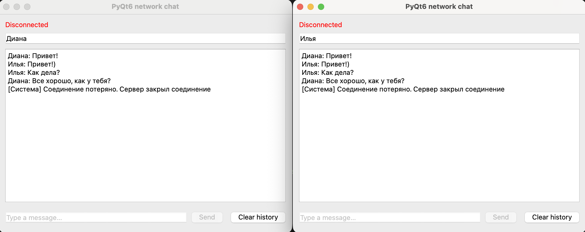

# Сетевой чат на PyQt6

## Домашняя работа
**Тема:** Обработка сетевых ошибок и завершение потоков в PyQt6

## Описание проекта

Приложение представляет собой сетевой чат, реализованный на Python с использованием библиотеки PyQt6 и TCP-сокетов.

Проект основан на исходном коде преподавателя и доработан без изменения основной архитектуры.

Чат позволяет нескольким пользователям обмениваться сообщениями через локальный сервер.

## Выполненные изменения

### 1. Обработка потери соединения

В классе `ReceiveThread` добавлена обработка сетевых ошибок с помощью `try/except`.

При возникновении ошибки или получении `None` от метода `recv()` поток отправляет сигнал `disconnected` с информацией о причине отключения.

После обнаружения отключения цикл получения сообщений завершается.

В классе `MainWindow` реализован обработчик `on_disconnected()`, который:

- изменяет состояние подключения на `Disconnected`;
- отображает индикатор красным цветом;
- выводит системное сообщение о потере соединения;
- блокирует отправку новых сообщений.

Интерфейс обновляется через механизм сигналов и слотов PyQt6.

### 2. Корректное завершение SendThread

В классе `SendThread` реализован метод `stop()`.

Для остановки используется существующая очередь `Queue`.

Метод `stop()` помещает в очередь специальное значение `None`.

При получении `None` поток выходит из цикла `run()` и завершает работу.

Также добавлен флаг `stopping`, который предотвращает добавление новых сообщений после запроса остановки.

### 3. Корректное закрытие приложения

В классе `MainWindow` переопределён метод `closeEvent()`.

При закрытии окна приложение:

1. Запрашивает остановку отправляющего потока.
2. Завершает сетевой обмен через `socket.shutdown()`.
3. Закрывает сокет.
4. Ожидает завершения `SendThread` и `ReceiveThread`.
5. Закрывает окно после завершения обоих потоков.

Ожидание потоков ограничено двумя секундами для каждого потока.

### 4. Дополнительное задание

Реализован индикатор состояния подключения.

Доступны два состояния:

- `Connected` — соединение с сервером установлено, зелёный цвет.
- `Disconnected` — соединение потеряно, красный цвет.

Изменение состояния происходит через сигнал `disconnected` и обработчик главного окна.

### 5. Дополнительные возможности чата

В рамках предыдущей самостоятельной работы реализованы:

- ввод имени пользователя;
- отображение имени отправителя рядом с сообщением;
- защита от отправки пустых сообщений;
- отправка сообщений по нажатию Enter;
- обработка обычных и системных сообщений;
- кнопка `Clear history` для локальной очистки истории.

## Проверки

Выполнены следующие проверки:

1. Запуск сервера и двух клиентов.
2. Обмен сообщениями между клиентами.
3. Отправка сообщений по Enter и кнопке Send.
4. Отключение сервера во время работы клиента.
5. Изменение индикатора на Disconnected.
6. Блокировка отправки после потери соединения.
7. Закрытие клиента при работающем сервере.
8. Закрытие клиента без отправки сообщений.
9. Закрытие клиента после отключения сервера.
10. Проверка синтаксиса файла main.py.

При проведённых проверках необработанных сетевых исключений в клиенте и ошибок уничтожения работающего QThread не обнаружено.

## Запуск проекта

Для работы необходим Python 3 и библиотека PyQt6.

Установка зависимости:

```bash
python3 -m pip install -r requirements.txt
```

Запуск сервера:

```bash
python3 server.py
```

Запуск клиента в другом терминале:

```bash
python3 main.py
```

Для проверки переписки можно запустить два экземпляра клиента.

Сервер работает на адресе `127.0.0.1` и порту `50505`.

## Скриншот



## Используемые технологии

- Python 3
- PyQt6
- TCP sockets
- QThread
- pyqtSignal
- Queue

## Исходный проект

https://github.com/katya-lessons/sockets/tree/master
